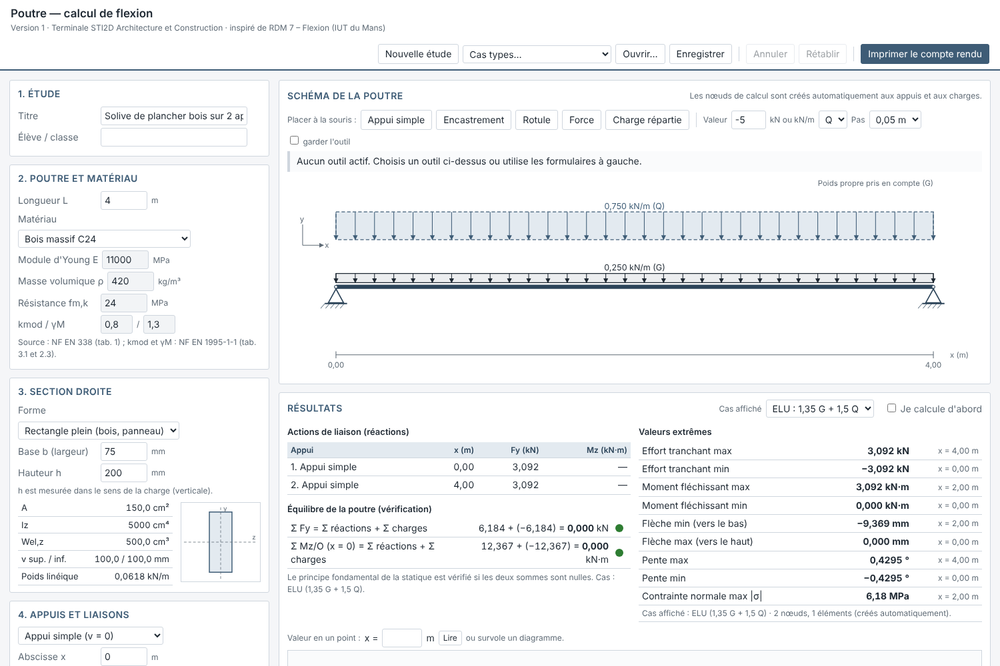
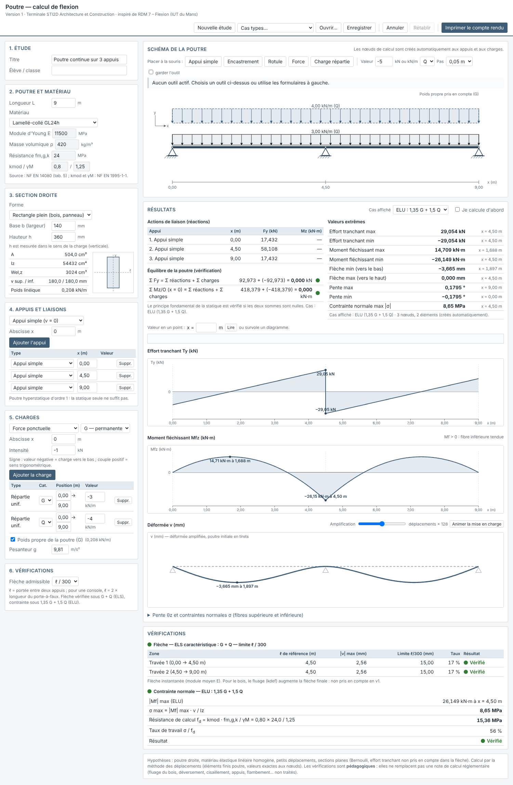
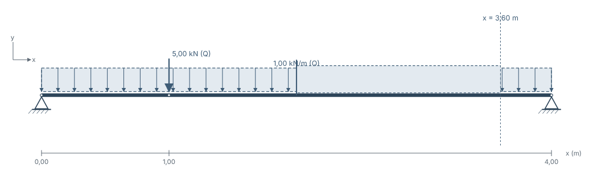
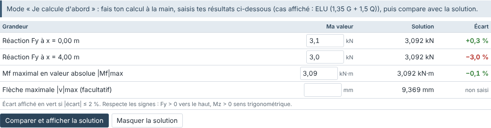

# RDM Lycée — calcul de poutres en flexion

Logiciel pédagogique de résistance des matériaux pour la **Terminale STI2D Architecture et Construction** (AC). Il calcule une poutre droite en flexion plane et montre, pas à pas, ce que l'élève doit comprendre : réactions d'appui, effort tranchant, moment fléchissant, flèche, contraintes, puis vérifications ELU / ELS.

Il s'inspire du logiciel **RDM 7 – Flexion** (Y. Debard, IUT du Mans) en corrigeant ses défauts d'ergonomie pour un public de lycéens. C'est **une seule page web autonome** : elle fonctionne hors ligne, sans installation, sur les PC du lycée, les tablettes et les Chromebooks.

## Ce que fait la version 1

- Poutre sur appuis simples, encastrements, rotules intérieures, pentes nulles, déplacements imposés, appuis élastiques.
- Charges ponctuelles, couples, charges réparties uniformes ou trapézoïdales, poids propre ; classement G / Q.
- Sections : rectangle, rond, tubes, I soudé, profilés IPE et HEA, section quelconque.
- Matériaux : acier S235, bois massif C24, lamellé-collé GL24h, panneaux de particules et MDF (valeurs indicatives), aluminium 6060 T6, béton C25/30 non armé.
- Diagrammes Ty, Mfz, flèche, lecture de valeur au survol, animation de la mise en charge.
- Vérifications ELU (1,35 G + 1,5 Q) et ELS (G + Q, flèche limite ℓ/200, ℓ/300 ou ℓ/500), équilibre de la poutre affiché.
- Mode « Je calcule d'abord » : l'élève saisit ses résultats, la solution reste masquée jusqu'à la comparaison.
- Annuler / Rétablir, outils à la souris qui disent toujours ce qu'ils attendent, enregistrement et réouverture d'une étude (.json), compte rendu imprimable (PDF).

## Captures

| Écran principal | Poutre continue |
|---|---|
|  |  |

| Charge répartie en cours de pose | Mode « Je calcule d'abord » |
|---|---|
|  |  |

## Utiliser le logiciel

- **Sans rien installer** : ouvre `dist/index.html` (après construction) ou la page publiée sur GitHub Pages. Un double-clic sur le fichier suffit ; on peut aussi le copier sur une clé USB ou le déposer sur Moodle.

## Lancer le projet sur ton ordinateur (développement)

Prérequis : [Node.js](https://nodejs.org/fr) version 20 ou plus récente (version LTS conseillée). Aucune autre dépendance.

```bash
npm test          # valide le moteur sur les 8 exemples du manuel RDM – Flexion (tolérance 0,1 %)
npm run build     # produit dist/index.html (un seul fichier, hors ligne)
npm run dev       # construit puis ouvre un petit serveur local : http://localhost:8080
```

Test d'interface (facultatif, il faut Python 3, `pip install playwright` et Chrome ou Chromium) :

```bash
npm run test:interface   # clique dans la page comme un élève et régénère docs/captures/
```

## Organisation du dépôt

```
src/moteur/      moteur de calcul (modules ES, sans dépendance)
  materiaux.js   matériaux et sources normatives
  sections.js    profilés du commerce et caractéristiques des sections
  outils.js      tolérances, pondération des charges
  calcul.js      méthode des déplacements (éléments poutre d'Euler-Bernoulli)
  index.js       point d'entrée (objet MoteurRDM)
src/interface/   page HTML, feuille de style, script d'interface
scripts/         build.mjs (construction de dist/) et serveur.mjs (serveur local)
tests/           validation du moteur (node --test) et test d'interface (Python)
docs/            captures d'écran et fiches de référence RDM 7
dist/            page construite, publiée sur GitHub Pages (non versionnée)
```

## Publier sur GitHub Pages, pas à pas

Une fois publié, le logiciel est accessible par une adresse du type `https://ton-identifiant.github.io/rdm-lycee/`, à donner aux élèves ou à mettre dans Moodle.

1. **Crée un compte** sur [github.com](https://github.com) si tu n'en as pas.
2. **Crée un dépôt vide** : bouton « New repository », nom `rdm-lycee`, visibilité « Public » (GitHub Pages gratuit exige un dépôt public), **ne coche rien** (pas de README, pas de licence : ils existent déjà).
3. **Envoie le projet** depuis le dossier `rdm-lycee` (terminal ou Git Bash sous Windows) :
   ```bash
   git remote add origin https://github.com/TON-IDENTIFIANT/rdm-lycee.git
   git push -u origin main
   ```
   GitHub demande de s'identifier : le plus simple est d'installer [GitHub CLI](https://cli.github.com/) puis de taper `gh auth login` une fois.
4. **Active GitHub Pages** : dans le dépôt, onglet **Settings** → **Pages** → rubrique « Build and deployment » → **Source : GitHub Actions**.
5. **Lance la publication** : onglet **Actions** → « Publier sur GitHub Pages » → « Run workflow » (ou envoie simplement un nouveau commit sur `main`). Le robot lance les tests, construit la page et la publie. Une coche verte = c'est en ligne ; l'adresse s'affiche dans Settings → Pages.
6. **Ensuite**, chaque `git push` sur `main` republie automatiquement. Si un test échoue, rien n'est publié et l'ancienne version reste en ligne.

## Sources

Calcul et exemples de validation :
- Y. Debard, *RDM – Flexion*, manuel d'exercices du logiciel RDM 7, IUT du Mans, Université du Mans — exemples 1 à 8 (§6) utilisés pour les tests : <https://iut.univ-lemans.fr/ydlogi/> (site des logiciels et cours de Y. Debard).

Données matériaux, profilés et charges (citées aussi dans le code, à côté de chaque valeur) :
- NF EN 10365 — profilés en acier laminés à chaud en I et H : dimensions, masses et caractéristiques (IPE, HEA).
- NF EN 1993-1-1 et son annexe nationale NF EN 1993-1-1/NA — calcul des structures en acier (E, fy, γM0).
- NF EN 338 — bois de structure, classes de résistance (C24).
- NF EN 14080 — bois lamellé-collé (GL24h).
- NF EN 1995-1-1 — calcul des structures en bois (kmod, γM ; kdef pour la v1.1).
- NF EN 12369-1, NF EN 312, NF EN 622-5 — panneaux à base de bois (valeurs indicatives).
- NF EN 1999-1-1 — calcul des structures en aluminium.
- NF EN 1992-1-1 — calcul des structures en béton (C25/30).
- NF EN 1990 et NF EN 1991-1-1 — bases de calcul (combinaisons ELU / ELS), poids volumiques et charges d'exploitation.

Les normes NF EN sont publiées par l'AFNOR : <https://www.boutique.afnor.org>.

## Licence

Code sous licence MIT (voir `LICENSE`). Le logiciel RDM 7 et ses manuels restent la propriété de leur auteur (IUT du Mans) ; ce projet n'en reprend aucun code.
